# Runner execution architecture

This subsystem page explains how a simulation is assigned to compute, how runner
identity and health connect to the control plane, and how evidence returns. It is
part of the [system architecture and engineering specification](../EngineeringSpec.md#3-system-architecture),
not a diagram of every application feature. Identity, organization/project access,
suite authoring and comparisons retain their own ownership in that specification.

## Approved architecture

[View the architecture SVG](../diagrams/runner-execution-architecture.svg) ·
[Editable Archify source](runner-execution-architecture.json)

Human approval: October 29, 2026, P08 chat
`01a18386-c91e-73a1-884d-1813348a238b`, turn
`01a187dd-f9eb-74c0-9aca-ff79cca43715`, message
`01a187dd-fa12-7072-ad2f-989f7b461e14`: “ok i approve to architecture design approve”.

The approved scope is managed cloud execution by default with optional connected
customer machines; trusted controller credentials outside the disposable simulation
guest; a common evidence/evaluation path; the existing DDD-oriented modular
monolith; and the highlighted P08 runner identity/enrollment/health boundary.
The separately shown application UI was approved in message
`01a187df-cc31-7501-b8ce-7660d49851dd`: “ok good , i approve the UI”. These approvals
are for the shown design. They do not publish the phase, dispatch later increments,
create cloud resources or authorize deployment.

Yellow markers label **partial P08 slices**: browser enrollment/health UI, API
identity/health operations, runner/grant database records, and local credential/idle
heartbeat transport. These are implemented locally for phase review; the whole API,
database and runner execution engine are not delivered by P08. P09 retains local
inventory/registration binding and qualification remains separately owned.

The API and maintenance process share domain/application rules. Maintenance is a
later scheduled entry point for lease expiry, finalization and retention; P08 derives
connection health from heartbeat age and does not start a maintenance worker. The
cloud controller will manage attempts outside customer code, while the disposable
guest contains PX4/SIH and the scenario adapter. A reaper must recover orphaned
cloud resources if a controller fails. Optional customer execution keeps simulator
control local, with outbound authenticated transport. Neither route bypasses server
evidence validation or treats worker-reported metadata as verified capability.

## Deployment child diagram — proposal

[View the deployment SVG](../diagrams/runner-execution-deployment.svg) ·
[Editable Archify source](runner-execution-deployment.json)

This child diagram shows where the subsystem's trusted application services,
private data services, disposable guests and customer machines would live. The
[execution hosting and rollout plan](../plans/execution-hosting.md) owns the proposed
AWS topology, staged rollout, limits, qualification and rollback gates. It also maps
later image/isolation and controller/reaper increments. Those services and resources
are not provisioned by P08. Deployment execution still needs a concrete account,
region, resources, cost and action approval.

Keep the final SVG diagrams, editable JSON sources and this Markdown approval record together. Interactive HTML viewers can be regenerated locally from the JSON when needed; generated HTML and delivery receipts are ignored and must not be committed. Remove temporary review captures, preview code and unused build output before PR submission.
